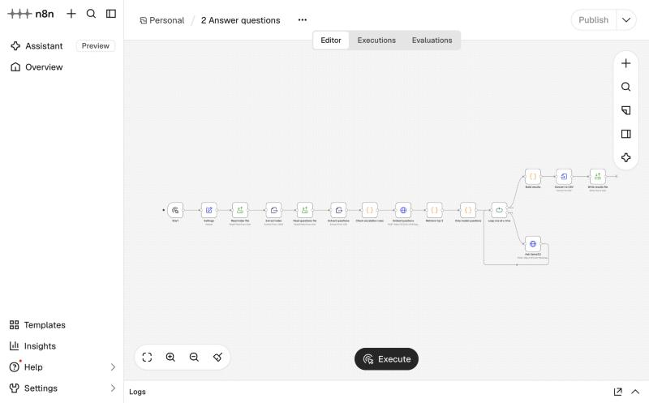

# Support Bot QA Loop

A personal project: a repeatable quality-assurance loop for a support chatbot,
built with **n8n Community Edition** and **Ollama**, running fully locally and free.

The chatbot answers questions about **Kerbloop**, a fictional last-mile delivery
software (route planning for dispatchers, a driver app, customer tracking links).
The loop measures how well the bot answers a frozen set of 40 test questions,
labels every failure, points at the articles or rules that caused it, and
shows the effect of the fixes in a before/after report.

> All companies, products, teams and data in this repository are fictional.
> Kerbloop is an invented name and is not affiliated with any real company.

## Result

| Run | Knowledge base | Pass rate | wrong_answer | missing_content | retrieval_miss | dead_end | bad_escalation | made_up |
|---|---|---|---|---|---|---|---|---|
| run_v1 (baseline) | kb/v1, 25 articles | **26/40 (65.0%)** | 8 | 1 | 1 | 2 | 2 | 0 |
| run_v2 (after fixes) | kb/v2, 26 articles | **30/40 (75.0%)** | 6 | 0 | 1 | 3 | 0 | 0 |

- Reports: [`reports/report_run_v1.md`](reports/report_run_v1.md), [`reports/report_run_v2.md`](reports/report_run_v2.md)
- What was fixed, and what was deliberately not fixed: [`docs/changelog.md`](docs/changelog.md)

kb/v1 contained three planted flaws (an outdated fact, two contradicting
articles and a missing article). The loop found all three in the baseline run.

## How it works

```
kb/<version>/*.md ──► 1 Index ──► data/index_<version>.json
                                        │
data/test_questions.csv ──► 2 Answer ◄──┘ ──► data/results_<run_id>.csv
                                                     │
                            3 Review ◄───────────────┘ ──► data/labels_<run_id>.csv
                                                                  │
                            4 Report ◄────────────────────────────┘ ──► reports/report_<run_id>.md
```

| Workflow | What it does |
|---|---|
| **1 Index** | Reads every article, splits off the front matter (`id`, `title`, `last_reviewed`, `owner`) and embeds the text with `nomic-embed-text` (768 numbers per article). |
| **2 Answer** | For each question: (1) escalation keywords are checked in code first, the model is never asked; (2) the question is embedded and the 3 most similar articles are found with cosine similarity; (3) if the best score is below the threshold, the bot says "I don't know"; (4) otherwise `llama3.2:3b` answers with a strict prompt: only from the articles, cite the article id, or reply exactly "I don't know". Questions go to the model one at a time; temperature 0, seed 42. |
| **3 Review** | Labels every answer deterministically against the frozen expectations: `correct`, `wrong_answer`, `missing_content`, `retrieval_miss`, `dead_end`, `bad_escalation`, `made_up`. Every 4th question is marked for a manual spot check. |
| **4 Report** | Pass rate, labels, pass rate per category, articles to fix, rules and settings to check, spot-check result, and a before/after table over all runs. |



More screenshots: [1 Index](screenshots/workflow1_index.jpg),
[3 Review](screenshots/workflow3_review.jpg), [4 Report](screenshots/workflow4_report.jpg).

### Design decisions

- **The LLM never decides escalation.** Billing, invoices, refunds, legal,
  GDPR, complaints, cancelling a contract and "speak to a human" are caught by
  keyword rules before any model runs.
- **The test set is frozen** (`data/test_questions.csv`, 40 questions: 31 to
  answer, 6 to escalate, 3 the bot should not know). Fixes change articles
  and rules only, never the questions.
- **The similarity threshold was tuned once** on 10 separate tuning questions,
  never on the test set: [`docs/threshold_tuning.md`](docs/threshold_tuning.md).
  The planned value 0.45 never triggered with this model (all scores > 0.66),
  so 0.68 was chosen.
- **Only one model in memory at a time** (8 GB laptop): the embedding model is
  unloaded (`keep_alive: 0`) before llama3.2 answers.

### Limitations

- `llama3.2:3b` is small: in 6 questions it had the right article and still
  answered wrongly, and with the new ADR-006 it still said "I don't know".
- The 0.68 threshold blocks two answerable questions (Q23, Q31). It was not
  changed, because changing it after seeing test results would tune on the test set.
- Labels use keyword matching, which can miss correct answers worded
  differently. The manual spot check (10 of 10 labels confirmed for run_v1)
  is the safeguard.
- The escalation fix in v2 was found with two test questions; it is listed as
  a test-informed change in the changelog.
- 40 questions is a small test set; a 10-point change equals 4 questions.

## Run it yourself

Requirements: macOS or Linux, [Ollama](https://ollama.com), Node.js 24 (n8n 2.x
does not install on Node 25).

```bash
ollama pull llama3.2:3b
```

```bash
ollama pull nomic-embed-text
```

Start n8n from the project folder and allow it to read and write project files:

```bash
N8N_RESTRICT_FILE_ACCESS_TO="$PWD" N8N_DIAGNOSTICS_ENABLED=false npx n8n
```

Then open http://localhost:5678, create the local owner account, import the
four files from `workflows/` (Workflows → Import from file), set `project_dir`
in each **Settings** node to your project folder, and execute the workflows
in order 1 → 4. The **Settings** node of each workflow also holds the
knowledge-base version and the run id.

## Repository layout

```
kb/v1, kb/v2         knowledge-base articles (Markdown with front matter)
data/                test and tuning questions, results and labels per run
                     (index_*.json is rebuilt by workflow 1 and not committed)
workflows/           n8n workflow exports 1-4
reports/             QA report per run
docs/                changelog, threshold tuning, release checklist
screenshots/         the workflows in n8n
```

## Tools

n8n Community Edition (Sustainable Use License), Ollama (MIT), llama3.2:3b
(Llama 3.2 Community License), nomic-embed-text (Apache 2.0). No paid or cloud
services are used.

The knowledge base, test questions and workflow code were drafted with the
help of an AI coding assistant and reviewed by me.

## License

Code and workflows: MIT (see [LICENSE](LICENSE)). Knowledge-base articles and
documentation: [CC BY 4.0](https://creativecommons.org/licenses/by/4.0/).
